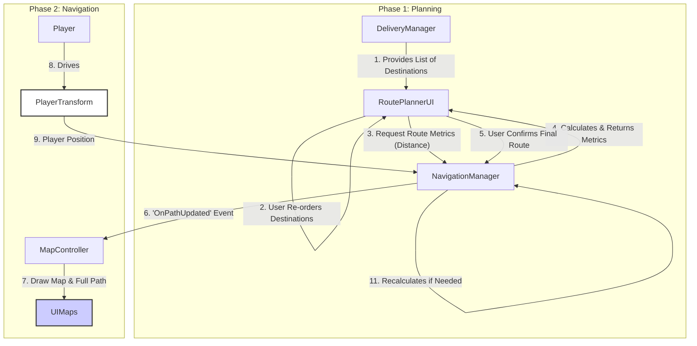

### Map & Navigation System Implementation Plan

- **Version:** 1.3 (Locked)
- **Date:** 2023-10-27
- **Deliverable:** A comprehensive system for route planning, a minimap, a full-screen map menu, and A\* pathfinding for navigation.

---

### 1. Step-by-Step Audit/Verification Guide

1.  **`Pathfinder.cs`:**
    - **Location:** `Assets/Scripts/Navigation/Pathfinder.cs`
    - **Verify:** Contains a non-MonoBehaviour class with the A\* algorithm implementation. Look for the `FindPath` method which should take a start node, end node, and `MapData` object. It should not reference Unity's API directly where possible to keep it a pure C# class.
2.  **`NavigationManager.cs`:**
    - **Location:** `Assets/Scripts/Navigation/NavigationManager.cs`
    - **Verify:** A singleton `MonoBehaviour`. It should have references to `MapData` and an instance of the `Pathfinder`. Check for public methods like `RequestPath(startPos, endPos)` and events like `OnPathUpdated`. It will be responsible for finding the closest nodes to the start/end positions.
3.  **`MapController.cs` (for Minimap and Map Menu):**
    - **Location:** `Assets/Scripts/UI/MapController.cs`
    - **Verify:** This script will manage rendering the map display (both minimap and full map). It will listen to `NavigationManager.OnPathUpdated`. It should handle drawing the street network and the calculated path. It will also manage player and destination icons.
4.  **Integration with `DeliveryManager.cs`:**
    - **Location:** `Assets/Scripts/Delivery/DeliveryManager.cs`
    - **Verify:** The `DeliveryManager` should be modified to call `NavigationManager.RequestPath`, providing a list containing the single destination. Other game systems should be able to call this with multiple waypoints.

---

### 2. Core Vision & Goals

- **High Concept:** Implement a flexible, multi-stop navigation system inspired by modern open-world games and GPS apps like Google Maps, featuring a pre-run route optimization phase.
- **Core Loop:** The player is presented with a set of destinations. They can order them to find the optimal route. Once confirmed, the system calculates the path and displays it on a vector-based minimap and a full-screen map, guiding the player and recalculating automatically if they stray too far.
- **Player Fantasy:** Feeling like an efficient courier who can intelligently plan their route before driving, then rely on a smart GPS that guides them through a complex, multi-stop journey.

---

### 3. Analysis of Pre-existing Assets/Attempts

- **`GeoJSONProcessor.cs`:** Successfully creates a graph data structure (`MapData.RoutingNodes`) from GeoJSON data. This graph is the perfect foundation for an A\* pathfinding algorithm, as it contains nodes (intersections) and their connections.
- **`MapData.cs`:** Provides a clean data structure for both the visual street layout (`Streets`) and the logical routing graph (`RoutingNodes`).
- **`DeliveryManager.cs`:** Manages game objectives. It will provide a list of potential delivery locations to the new `RoutePlannerUI`.

---

### 4. Proposed Architecture

The architecture is updated to include a `RoutePlannerUI` for pre-run optimization and shows the flow for both planning and navigation.

- **`RoutePlannerUI.cs` (New):** A UI-focused `MonoBehaviour` that receives a list of destinations, allows the user to re-order them, and queries the `NavigationManager` to get the total distance for the current order to help the user decide on the best route.
- **`NavigationManager.cs` (Coordinator):** Responsibilities are expanded. It will now expose a non-coroutine method, `CalculateRouteDistance(List<Vector3> waypoints)`, for quick metric calculations. It will also contain the logic to check if the player has strayed too far from the path and trigger a recalculation.
- **`MapController.cs` (View):** Now handles pan-and-zoom input for the full-screen map. It does not display waypoint icons, only the calculated path.

---

### 5. Final Design Decisions

Based on the workshop, the following decisions have been finalized:

- **Map Rendering:** The map will be rendered using a **vector-based approach**.
- **Path Visualization:** The route will **only be displayed on the UI maps**. No in-world or UI icons for waypoints will be shown, only the line path.
- **Path Snapping:** Pathfinding will originate from the **closest point on a street segment**.
- **Decoupling & Multi-Stop:** The system is designed for **multi-stop journeys** and is independent from any single game system.
- **Minimap Rotation:** The minimap rotates to match the **current street segment's direction**. When off-road, the player's icon will be visually snapped to the nearest point on the existing route, and the map's orientation will remain locked to the path.
- **Route Planning:** A **pre-run route planning screen** will appear when the player receives new deliveries. It will allow the user to re-order destinations and see the **total distance** for the selected route.
- **Path Recalculation:** The route will **recalculate automatically** if the player moves a configurable distance away from the planned path.
- **Map Interaction:** The initial implementation of the full-screen map will support **Pan and Zoom**. Setting custom waypoints is deferred.

---

### 6. Implementation Roadmap

1.  **`Pathfinder.cs`:** No changes to the core A\* logic.
2.  **`NavigationManager.cs`:**
    a. Implement the primary `RequestPath(List<Vector3> waypoints)` coroutine.
    b. Implement the synchronous `public float CalculateRouteDistance(List<Vector3> waypoints)` method for the planner UI.
    c. In `Update()`, add the logic to check player distance against the current path and trigger a recalculation if `distance > recalculationThreshold`.
3.  **`RoutePlannerUI.cs`:**
    a. Create the UI layout for a list of destinations.
    b. Implement drag-and-drop or button-based re-ordering.
    c. On any order change, call `NavigationManager.CalculateRouteDistance` and update a "Total Distance" text field.
    d. A "Confirm" button will call `NavigationManager.RequestPath` with the final order and hide the planner UI.
4.  **`MapController.cs`:**
    a. Implement the vector-based map and path drawing.
    b. Implement input handling for panning (dragging) and zooming (scrolling) the map view.
    c. Implement the minimap rotation and off-road player icon snapping logic in `Update()`.
5.  **Integration:**
    - `DeliveryManager` will now activate the `RoutePlannerUI` and provide it with destinations instead of directly calling `NavigationManager`.

---

### 7. Detailed Script Implementation Tables

#### `Pathfinder.cs`

| Step             | Action Plan                                                                                                                                                                                       |
| ---------------- | ------------------------------------------------------------------------------------------------------------------------------------------------------------------------------------------------- |
| 1. Skeleton      | Create a standard C# class `Pathfinder`. Create a helper nested class `PathNode` to store A\* cost data (`gCost`, `hCost`, `parent`).                                                             |
| 2. Logic         | Implement `public List<RouteNode> FindPath(MapData mapData, int startNodeId, int endNodeId)`. This method will contain the A\* algorithm using a `PriorityQueue` for the open set for efficiency. |
| 3. Documentation | Add XML-docs explaining the A\* implementation.                                                                                                                                                   |

#### `NavigationManager.cs`

| Step             | Action Plan                                                                                                                                                                                                                                                                                                                                                                                                                                                                                                                              |
| ---------------- | ---------------------------------------------------------------------------------------------------------------------------------------------------------------------------------------------------------------------------------------------------------------------------------------------------------------------------------------------------------------------------------------------------------------------------------------------------------------------------------------------------------------------------------------- |
| 1. Skeleton      | Create `NavigationManager : MonoBehaviour` with a static `Instance`.                                                                                                                                                                                                                                                                                                                                                                                                                                                                     |
| 2. Properties    | Add `[SerializeField] private GeoJSONProcessor _mapProcessor;`, `public event Action<List<Vector3>> OnPathUpdated;`, `public float recalculationThreshold = 20f;`.                                                                                                                                                                                                                                                                                                                                                                       |
| 3. Logic         | - `Awake()`: Set up the singleton.   - `public void RequestPath(List<Vector3> waypoints)`: The main coroutine for path calculation.   - `public float CalculateRouteDistance(List<Vector3> waypoints)`: A synchronous method that calculates total path length for the planner.   - `Update()`: Check `Vector3.Distance(player.position, FindClosestPointOnPath(player.position))` and if it's greater than `recalculationThreshold`, request a new path from the player's current position to the _remaining_ destinations. |
| 4. Gizmos        | Draw the final, stitched path and the recalculation radius around the player.                                                                                                                                                                                                                                                                                                                                                                                                                                                            |
| 5. Documentation | Document public methods and the `OnPathUpdated` event. Explain the multi-stop logic.                                                                                                                                                                                                                                                                                                                                                                                                                                                     |

#### `MapController.cs`

| Step             | Action Plan                                                                                                                                                                                                                                 |
| ---------------- | ------------------------------------------------------------------------------------------------------------------------------------------------------------------------------------------------------------------------------------------- |
| 1. Skeleton      | Create `MapController : MonoBehaviour`.                                                                                                                                                                                                     |
| 2. Properties    | Add fields for `_mapImage`, `_playerIcon`, `_streetColor`, `_pathColor`. Remove all icon-related properties.                                                                                                                                |
| 3. Logic         | - Implement map drawing and path rendering.   - In `Update()`, handle map rotation and player icon snapping.   - Implement input handlers for `OnDrag` and `OnScroll` events for pan and zoom functionality on the full-screen map. |
| 4. Documentation | Document the inspector fields and the input handling for pan/zoom.                                                                                                                                                                          |

#### `RoutePlannerUI.cs` (New Script)

| Step             | Action Plan                                                                                                                                                                                                                                                                                                                                                                                                                                           |
| ---------------- | ----------------------------------------------------------------------------------------------------------------------------------------------------------------------------------------------------------------------------------------------------------------------------------------------------------------------------------------------------------------------------------------------------------------------------------------------------- |
| 1. Skeleton      | Create `RoutePlannerUI : MonoBehaviour`.                                                                                                                                                                                                                                                                                                                                                                                                              |
| 2. Properties    | References to UI elements (list container, waypoint item prefab, confirm button, total distance text).                                                                                                                                                                                                                                                                                                                                                |
| 3. Logic         | - `public void Populate(List<Vector3> destinations)`: Fills the UI list.   - Implement re-ordering logic (e.g., using `IDragHandler`).   - `private void UpdateRouteMetrics()`: Called after re-ordering; gets the new destination order, calls `NavigationManager.CalculateRouteDistance`, and updates the UI text.   - `OnConfirmButtonClicked()`: Calls `NavigationManager.RequestPath` with the final order and hides the planner UI. |
| 4. Documentation | Document the purpose of the script and its public `Populate` method.                                                                                                                                                                                                                                                                                                                                                                                  |

---

### 8. Gizmo & Debug Visualization

- **`NavigationManager`:**

  - When a path is calculated, `OnDrawGizmos` will draw the path. It will also draw a wire sphere around the player representing the `recalculationThreshold`.

- **`GeoJSONProcessor`:**
  - The existing Gizmos that draw the street network and nodes are excellent and will be preserved.
